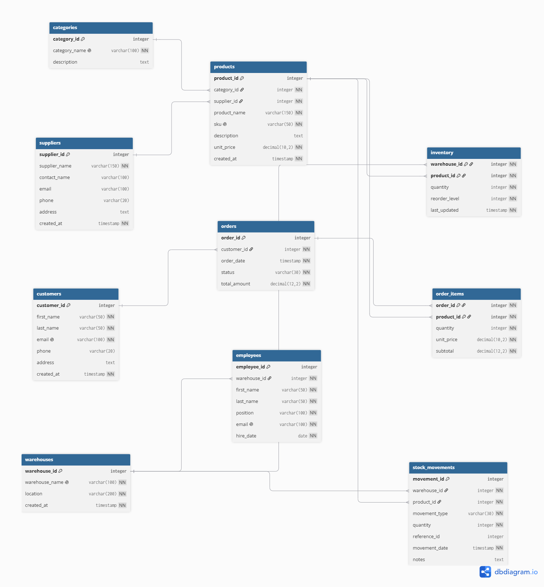

# Retail PostgreSQL DBA Project

## Objective
Design and administer a production-style PostgreSQL database for a retail inventory and order-management system, with a focus on data integrity, access control, query performance, and reliable backup and recovery.

## Scenario
A small computer-hardware retailer with two warehouses needs to track customers, products, suppliers, inventory, orders, and stock movements.

## Tech
- PostgreSQL 18
- pgAdmin 4
- dbdiagram.io (ERD)
- `pg_dump` / `pg_restore`

## Database Design


The model has 10 tables: `customers`, `categories`, `suppliers`, `products`, `warehouses`, `employees`, `inventory`, `orders`, `order_items`, `stock_movements`.

Design notes:
- `inventory` resolves the many-to-many relationship between products and warehouses.
- `order_items` resolves the many-to-many relationship between orders and products, and stores a price snapshot so historical orders keep the price actually charged.
- `stock_movements` keeps an auditable history of stock changes (signed quantities).

## Highlights
| Area | Result |
|---|---|
| Data integrity | 22 constraint tests, all invalid inserts rejected |
| Access control | 4 least-privilege roles, 11 allow/deny tests |
| Performance | Tested on about 1.4M rows; indexes chosen from `EXPLAIN (ANALYZE, BUFFERS)` evidence |
| Backup | `pg_dump -Fc`, 18.6 MB dump, restore verified by row counts; `backup.bat` / `restore.bat` scripts tested |
| Recovery | Deleted 750,000 `order_items` rows and recovered them in about 12 s (RPO = last backup) |

## Documentation
- [Constraint testing](docs/constraint-testing.md)
- [Analytical queries](docs/analytical-queries.md)
- [Security and least privilege](docs/security.md)
- [Performance tuning](docs/performance.md)
- [Backup and recovery](docs/backup-recovery.md)
- [Monitoring](docs/monitoring.md)
- Incident reports: [accidental data deletion](incidents/data-recovery.md), [slow query](incidents/slow-query.md), [unauthorized access attempts](incidents/security-incident.md)

## Status
- [x] Database design (ERD) ([details](database/01_erd/erd.png))
- [x] Schema, constraints, sample data ([details](database/02_tables.sql))
- [x] Constraint testing ([details](docs/constraint-testing.md))
- [x] Analytical queries and views ([details](docs/analytical-queries.md))
- [x] Security roles and least privilege ([details](docs/security.md))
- [x] Performance tuning (EXPLAIN ANALYZE, indexing) ([details](docs/performance.md))
- [x] Backup and recovery (RPO/RTO) ([details](docs/backup-recovery.md))
- [x] Incident simulation: accidental deletion ([details](incidents/data-recovery.md))
- [x] Monitoring (`pg_stat_*`) ([details](docs/monitoring.md))
- [x] Incident simulations: slow query ([details](incidents/slow-query.md)), unauthorized access ([details](incidents/security-incident.md))
- [x] Backup and restore scripts ([details](docs/backup-recovery.md#6-automation-backup-and-restore-scripts)); scheduling not set up

## How to rebuild the database
Create an empty database named `retail_operations`, then run the scripts in `database/` in order:

1. `02_tables.sql`
2. `03_sample_data.sql`
3. `04_queries.sql` (optional, analytical queries)
4. `05_views.sql`
5. `06_indexes.sql`
6. `roles.sql` (security roles and grants)

Backup and restore: run `backup/backup.bat`, and restore a dump into a separate database with `backup/restore.bat`. The password is read from `pgpass.conf`, not from the scripts.

Optional:
- `data/generate_data.sql` loads about 1.4M rows for performance testing. It truncates existing data first.
- `database/constraint_tests.sql` and `database/security_tests.sql` re-run the tests.
- `performance/performance_experiments.sql` reproduces the index experiments.

## Repository layout
```
database/      schema, sample data, queries, views, indexes, roles, tests
data/          bulk data generator
performance/   index experiments and EXPLAIN screenshots
monitoring/    pg_stat_* health-check queries
backup/        backup.bat and restore.bat
docs/          write-ups for each phase
incidents/     incident reports
screenshots/   evidence for each phase
```

## Known limitations
Backups are scripted (`backup/backup.bat`) but not scheduled, and they are stored on the same machine. There is no point-in-time recovery (WAL archiving) and backups are not encrypted. Roles are saved separately by the script with `pg_dumpall --globals-only`. See [Backup and recovery](docs/backup-recovery.md).
