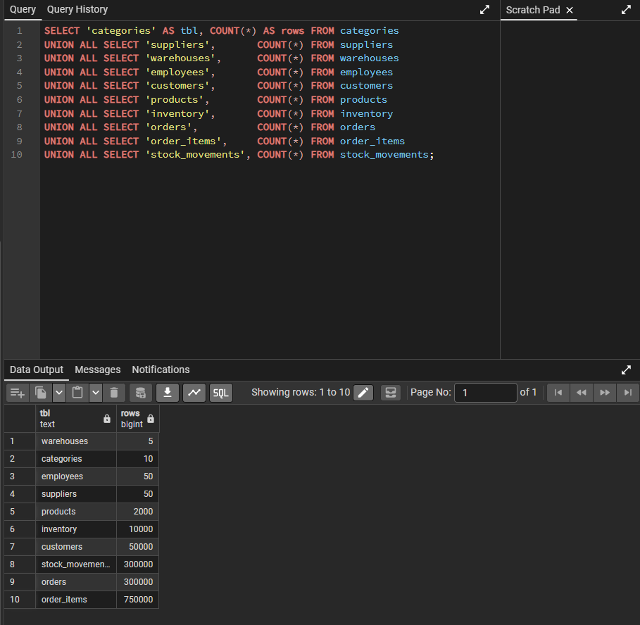
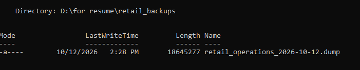
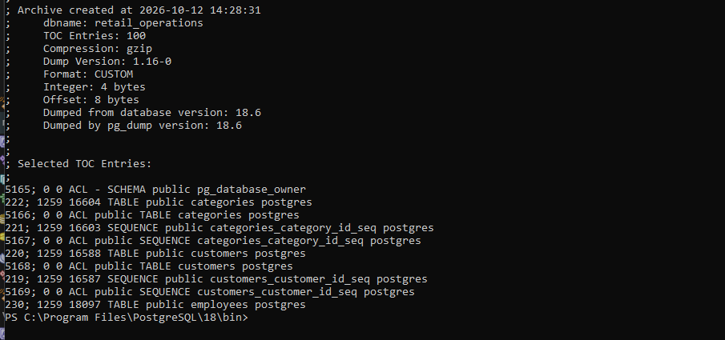
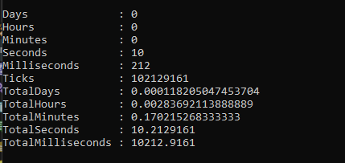
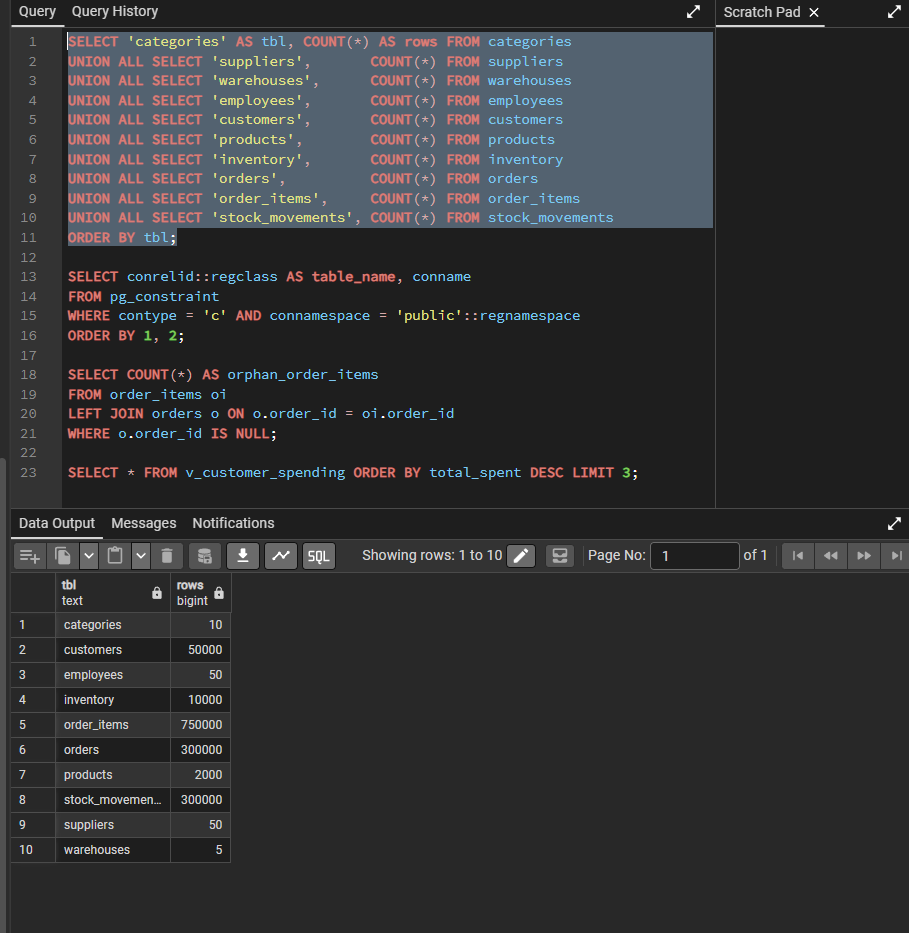

# Backup and Recovery

## Purpose
Show that the database can be backed up, that the backup can be restored, and that a data-loss incident can be recovered from. The incident itself is written up in [`incidents/data-recovery.md`](../incidents/data-recovery.md).

## Objectives

| Objective | Target | Meaning |
|---|---|---|
| RPO (recovery point objective) | 24 hours | At most one day of changes may be lost, so a full backup is needed at least daily |
| RTO (recovery time objective) | 30 minutes | Service must be restored within 30 minutes of deciding to recover |

## Backup Strategy
- **Tool:** `pg_dump` in custom format (`-Fc`), which is compressed and lets `pg_restore` restore a single table or the whole database.
- **Frequency:** one full backup per day (matches the 24-hour RPO). The backup in this document was taken manually; automating it is listed under Limitations.
- **Location:** `D:\for resume\retail_backups\`, outside the Git repository so dump files are never committed.
- **Naming:** `retail_operations_YYYY-MM-DD.dump`.

## 1. Record the Starting State
Row counts on `retail_operations` before the backup (10 tables):

| Table | Rows |
|---|---|
| categories | 10 |
| customers | 50,000 |
| employees | 50 |
| inventory | 10,000 |
| order_items | 750,000 |
| orders | 300,000 |
| products | 2,000 |
| stock_movements | 300,000 |
| suppliers | 50 |
| warehouses | 5 |



## 2. Take the Backup
```powershell
cd "C:\Program Files\PostgreSQL\18\bin"
.\pg_dump.exe -U postgres -h localhost -p 5432 -Fc -v -f "D:\for resume\retail_backups\retail_operations_2026-10-12.dump" retail_operations
```

| Item | Result |
|---|---|
| File | `retail_operations_2026-10-12.dump` |
| Size | 18,645,277 bytes (about 17.8 MB) |
| Created | 2026-10-12 14:28 |
| PostgreSQL version | 18.6 |



## 3. Verify the Backup Is Readable
A file with a size is not proof that it works, so its table of contents was listed:

```powershell
.\pg_restore.exe --list "D:\for resume\retail_backups\retail_operations_2026-10-12.dump"
```

The archive has 100 entries, including:
- all 10 tables, each with a `TABLE DATA` entry
- all 6 reporting views
- primary keys, unique constraints and 10 foreign keys
- the 3 indexes kept after performance tuning (the two experimental indexes that were dropped are correctly absent)
- the permissions (ACL entries) on tables and views

CHECK constraints are not listed separately because they are part of each table's definition.



## 4. Restore Test
The backup was restored into a new, separate database so the original was never at risk:

```powershell
.\createdb.exe -U postgres -h localhost -p 5432 retail_operations_restored
$sw = [Diagnostics.Stopwatch]::StartNew()
.\pg_restore.exe -U postgres -h localhost -p 5432 -d retail_operations_restored -v "D:\for resume\retail_backups\retail_operations_2026-10-12.dump"
$sw.Stop(); $sw.Elapsed
```

| Result | Value |
|---|---|
| Errors | None |
| Restore time | 10.2 seconds |
| Row counts | All 10 tables match the starting state |




## 5. Incident Recovery
All rows of `order_items` were deleted on purpose to simulate an accident, then restored from this backup with a table-level restore:

```powershell
.\pg_restore.exe -U postgres -h localhost -p 5432 -d retail_operations --data-only -t order_items "D:\for resume\retail_backups\retail_operations_2026-10-12.dump"
```

| Check | Before the delete | After the recovery |
|---|---|---|
| `order_items` rows | 750,000 | 750,000 |
| `SUM(subtotal)` | 67,894,256,963.56 | 67,894,256,963.56 |
| Recovery time | n/a | 12.0 seconds |

Full details are in [`incidents/data-recovery.md`](../incidents/data-recovery.md).

## RPO and RTO Assessment

| Objective | Target | Result |
|---|---|---|
| RTO | 30 minutes | Restore of the whole database took 10.2 seconds and recovery of one table took 12.0 seconds |
| RPO | 24 hours | Met only if a backup runs every day. In this exercise no changes were made between the backup and the deletion, so no data was lost |

The RTO figures measure the restore command on a small database (about 18 MB). A real recovery also includes detecting the problem, deciding what to restore and verifying the result, and a larger database takes longer to restore.

## Limitations
- **Backups are manual.** A scheduled daily job (for example Windows Task Scheduler running a backup script) is the next step.
- **The backup is on the same computer as the database.** A disk failure or theft could destroy both. A copy should also be kept on another device or in cloud storage.
- **No point-in-time recovery.** Anything changed after the last backup is lost. Archiving the write-ahead log (WAL) would allow recovery to a chosen moment.
- **Roles are not part of the dump.** The dump keeps permissions but not the roles themselves. Rebuilding on a new server also needs `pg_dumpall --globals-only`.
- **Backups are not encrypted.** The file contains all of the data.

## Findings
- A backup is only proven by restoring it. The restore into a separate database, with matching counts, is the evidence.
- A table-level restore (`--data-only -t`) is faster and less disruptive than restoring the whole database when only one table is damaged.
- A restore time measured on a small database shows the method works, but it is not a promise for a larger one.
