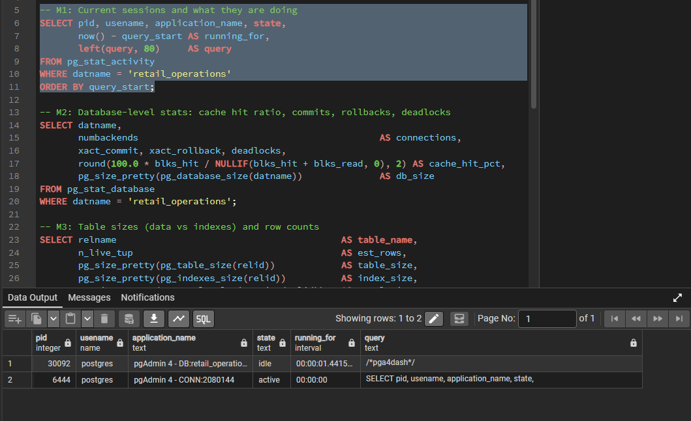
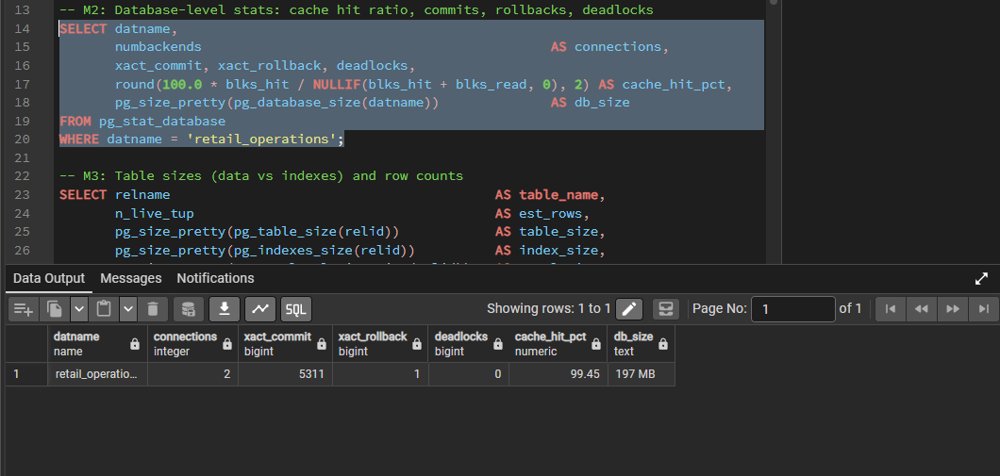
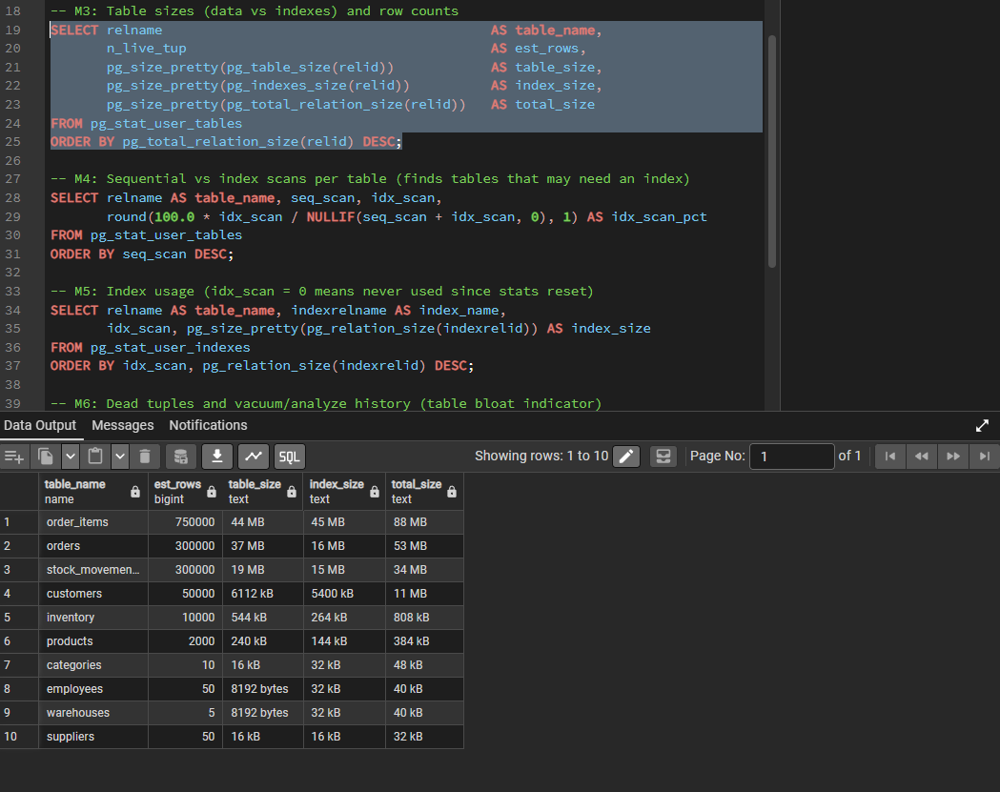
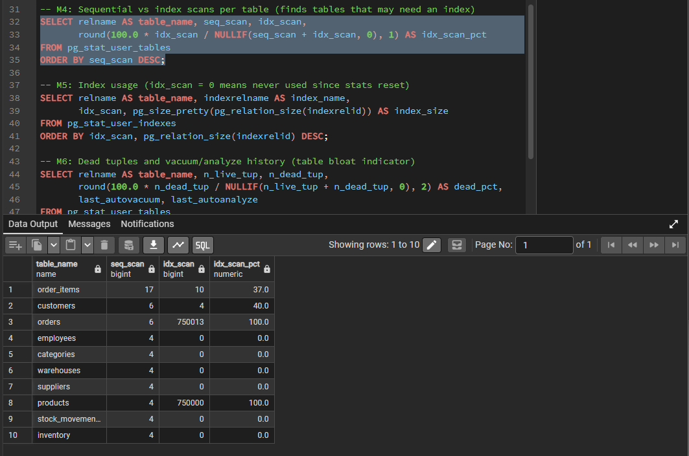
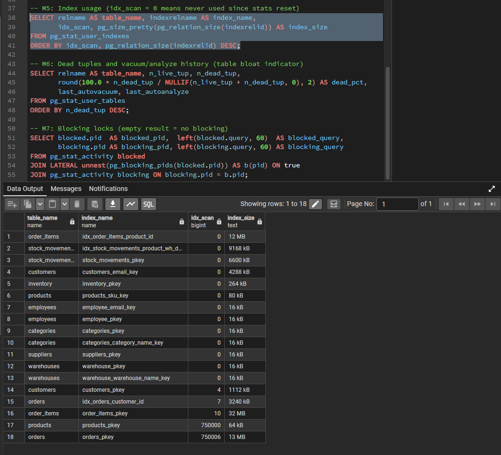
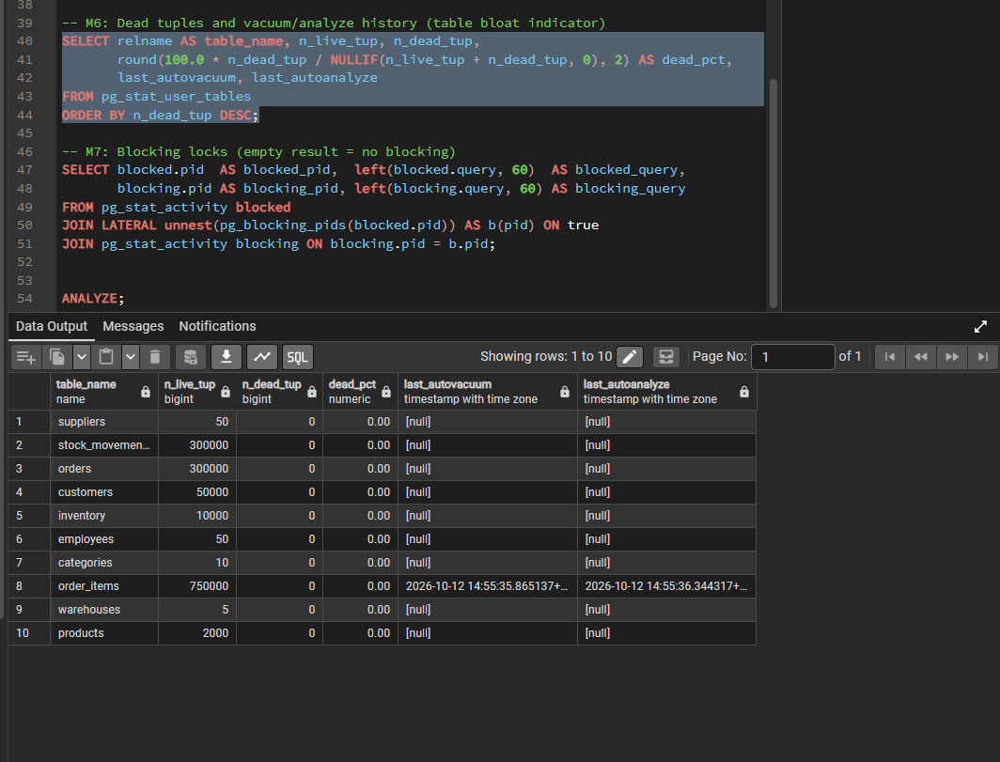
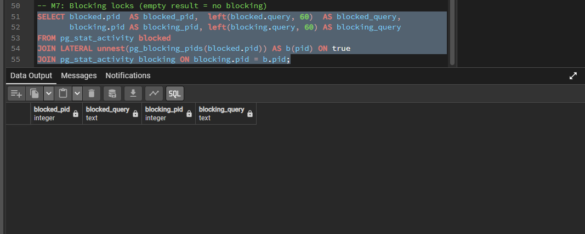

# Monitoring

Health checks for `retail_operations` using PostgreSQL's built-in statistics views. All queries are read-only and live in [`monitoring/monitoring.sql`](../monitoring/monitoring.sql). They were run as the `postgres` role on the 1.4M-row dataset, shortly after the data-loss recovery described in [`incidents/data-recovery.md`](../incidents/data-recovery.md).

## Summary

| Check | View | Result | Status |
|---|---|---|---|
| Sessions | `pg_stat_activity` | 2 sessions, both pgAdmin; nothing long-running | OK |
| Cache hit ratio | `pg_stat_database` | 99.45% | OK |
| Rollbacks / deadlocks | `pg_stat_database` | 1 rollback, 0 deadlocks | OK |
| Database size | `pg_database_size` | 197 MB | OK |
| Blocking locks | `pg_blocking_pids` | None | OK |
| Dead tuples | `pg_stat_user_tables` | 0 dead tuples; autovacuum has run on `order_items` | OK |
| Index usage | `pg_stat_user_indexes` | Two new indexes show 0 scans so far | Review after a normal workload |

---

## M1: Current sessions

Two sessions are connected, both from pgAdmin. One is idle and the other is the monitoring query itself. No long-running or stuck queries.

## M2: Database-level statistics

- **Cache hit ratio 99.45%.** Almost all reads are served from memory. A healthy OLTP target is above 99%.
- **1 rollback and 0 deadlocks** out of 5,311 commits. The rollback comes from the deliberate failed inserts during constraint testing.
- **Size 197 MB** for about 1.4M rows.

## M3: Table and index sizes

| Table | Table size | Index size | Total |
|---|---|---|---|
| order_items | 44 MB | 45 MB | 88 MB |
| orders | 37 MB | 16 MB | 53 MB |
| stock_movements | 19 MB | 15 MB | 34 MB |
| customers | 6112 kB | 5400 kB | 11 MB |
| inventory | 544 kB | 264 kB | 808 kB |
| products | 240 kB | 144 kB | 384 kB |

`order_items` is the largest table, and its indexes take about as much space as its data. That is the cost of the indexes: they speed up reads but add storage and slow down writes.

**Observation:** on the first run, `est_rows` showed 0 for most tables because their planner statistics had not been collected; only `order_items` had been analyzed by autovacuum. After running `ANALYZE;`, the estimates match the real row counts (300,000 orders, 50,000 customers, 2,000 products, and so on), as shown above. Without current statistics the query planner can choose poor plans, so this is worth checking after any bulk load.

## M4: Sequential vs index scans

`orders` (750,013 index scans) and `products` (750,000) stand out. That matches the 750,000-row `order_items` restore: each restored row triggers a foreign-key lookup in `orders` and `products` through their primary keys. This is the activity of the recovery, not application queries.

## M5: Index usage

| Index | Size | Scans |
|---|---|---|
| `idx_orders_customer_id` | 3240 kB | 7 |
| `idx_order_items_product_id` | 12 MB | 0 |
| `idx_stock_movements_product_wh_date` | 9168 kB | 0 |

The two zero-scan indexes were kept because the performance tests showed they help specific queries ([performance.md](performance.md)). Zero scans here only means the statistics window is short and contains mostly the restore workload. I would not drop them on this evidence. The check to repeat after a normal workload is: any index still at 0 scans after a representative period, and larger than the benefit it gives, is a candidate for removal.

## M6: Dead tuples and autovacuum

No table has dead tuples, so there is no bloat. Autovacuum and autoanalyze ran on `order_items` on 2026-10-12 right after the 750,000-row restore, which shows autovacuum triggers on its own after large changes. The other tables show `[null]` in `last_autoanalyze` because the manual `ANALYZE` was recorded under `last_analyze`, not `last_autoanalyze`.

## M7: Blocking locks

The result is empty, so no session is blocking another.

---

## Findings
1. The database is healthy: 99.45% cache hit, no deadlocks, no blocking, no bloat.
2. Refresh planner statistics with `ANALYZE` after bulk loads or restores. `pg_restore` of one table does not guarantee they are current.
3. Revisit index usage (M5) after a normal workload before deciding whether any index should be dropped.

## Not covered
`pg_stat_statements` (per-query timing history) needs a server restart to enable and is a natural next step. There is also no alerting; these checks are run by hand.
