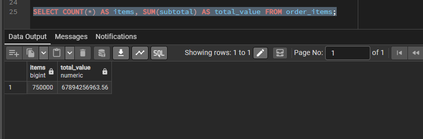
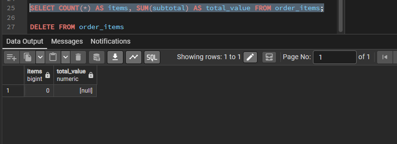
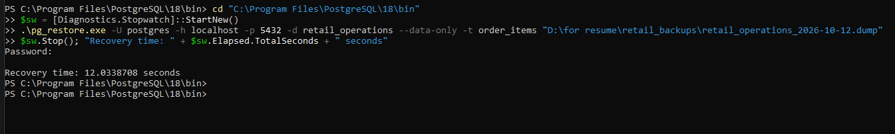
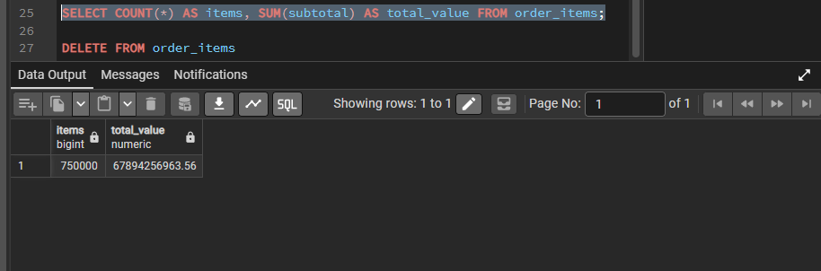
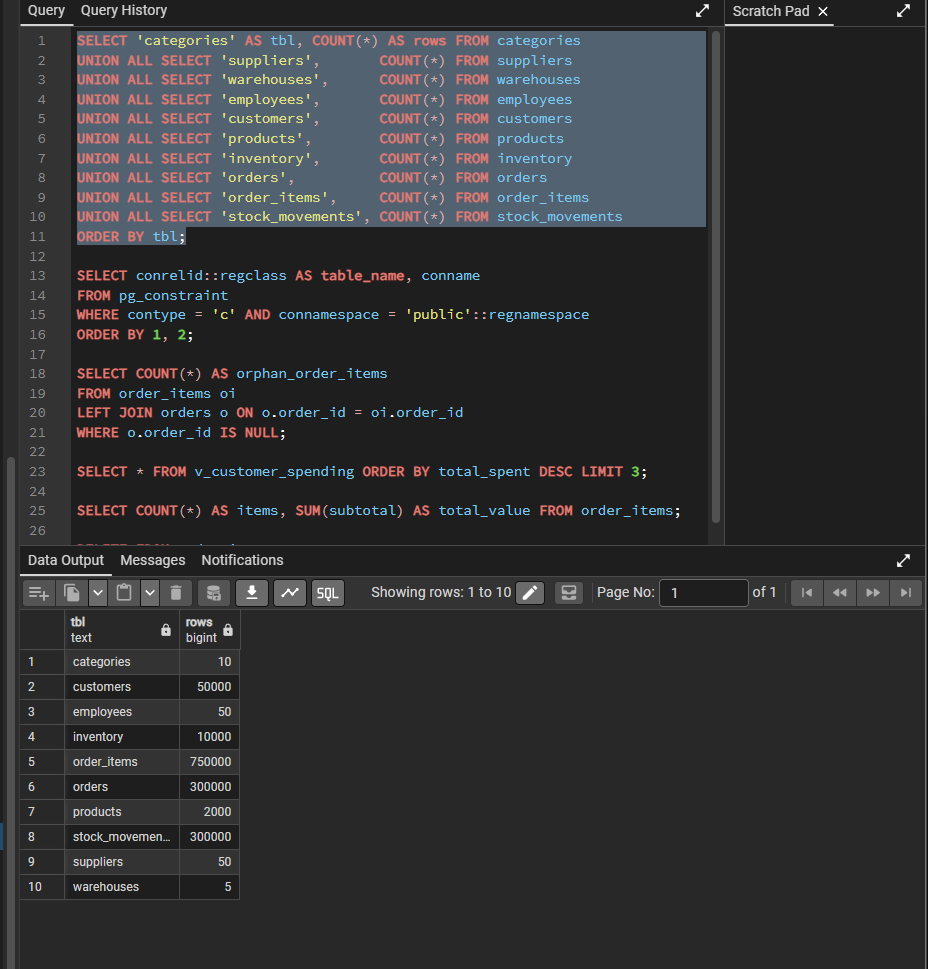

# Incident: Accidental Deletion of Order Items

## Summary

| | |
|---|---|
| **Incident** | All rows in `order_items` deleted by an unqualified `DELETE` |
| **Database** | `retail_operations` |
| **Type** | Simulated data-loss incident |
| **Recovery method** | Table-level restore from the daily full backup |
| **Data lost** | None in this simulation (no changes were made between the backup and the deletion) |
| **Recovery time** | 12.0 seconds (target: under 30 minutes) |

## What Happened
A `DELETE` statement was run with no `WHERE` clause, which removes every row:

```sql
DELETE FROM order_items;
```

`order_items` was chosen because no other table references it, so the delete is not blocked by foreign keys. A delete on `customers` or `products` would have been refused, as shown in the constraint tests.

## Impact
- All 750,000 order lines were removed.
- The three reporting views built on `order_items` (`v_product_sales`, `v_category_revenue`, `v_customer_spending`) would show no sales.
- Orders and customers remained, so every order would look like it had no items.




## Investigation
1. Compare the current row counts with the counts recorded before the backup.
2. Confirm that only `order_items` is affected. Every other table matches its original count, so a single-table recovery is enough and the whole database does not need to be restored.
3. Confirm that a usable backup exists. The latest is `retail_operations_2026-10-12.dump`, verified earlier with `pg_restore --list` and a full test restore.

## Recovery
Only the data of the damaged table was restored, into the existing empty table:

```powershell
cd "C:\Program Files\PostgreSQL\18\bin"
$sw = [Diagnostics.Stopwatch]::StartNew()
.\pg_restore.exe -U postgres -h localhost -p 5432 -d retail_operations --data-only -t order_items "D:\for resume\retail_backups\retail_operations_2026-10-12.dump"
$sw.Stop(); "Recovery time: " + $sw.Elapsed.TotalSeconds + " seconds"
```

`--data-only` loads rows without recreating the table, and `-t order_items` limits the restore to that table. It only works if the table is empty. If rows were still present, the load would stop on duplicate primary keys, which also protects against restoring on top of existing data by mistake.

Result: **Recovery time: 12.0 seconds.**



## Verification
The same query was run before the deletion and after the recovery:

```sql
SELECT COUNT(*) AS items, SUM(subtotal) AS total_value FROM order_items;
```

| | Before the delete | After the recovery |
|---|---|---|
| Rows | 750,000 | 750,000 |
| Total value | 67,894,256,963.56 | 67,894,256,963.56 |

The total value is checked as well as the count, because a row count can match while the contents differ.



Finally, the row counts of all 10 tables were compared with the original counts:



## Root Cause
A destructive statement was run directly on the live database with no `WHERE` clause and no safety check.

## Prevention
- **Least privilege.** `application_user` has no `DELETE` privilege at all, so the application cannot delete rows. This was verified in the security tests ([`docs/security.md`](../docs/security.md)). Only administrators can run this kind of statement.
- **Check before committing.** Run destructive statements inside a transaction, review the number of rows affected, and only then commit:

```sql
BEGIN;
DELETE FROM order_items WHERE order_id = 1;
-- check the "rows affected" count, then:
ROLLBACK;   -- or COMMIT; if the count is what you expected
```

- **Regular, tested backups.** A daily backup limits the loss, and the restore test proves it works.
- **Point-in-time recovery.** For a production system, archiving the write-ahead log would allow recovery to the moment just before the mistake instead of the last backup.

## Lessons
- Recovery was fast because the damage was limited to one table and a verified backup was already on hand.
- In a real incident, changes made after the last backup would be lost, which is why the backup frequency (RPO) matters.
- Verifying with a total value as well as a row count gives stronger evidence that the data is back.
