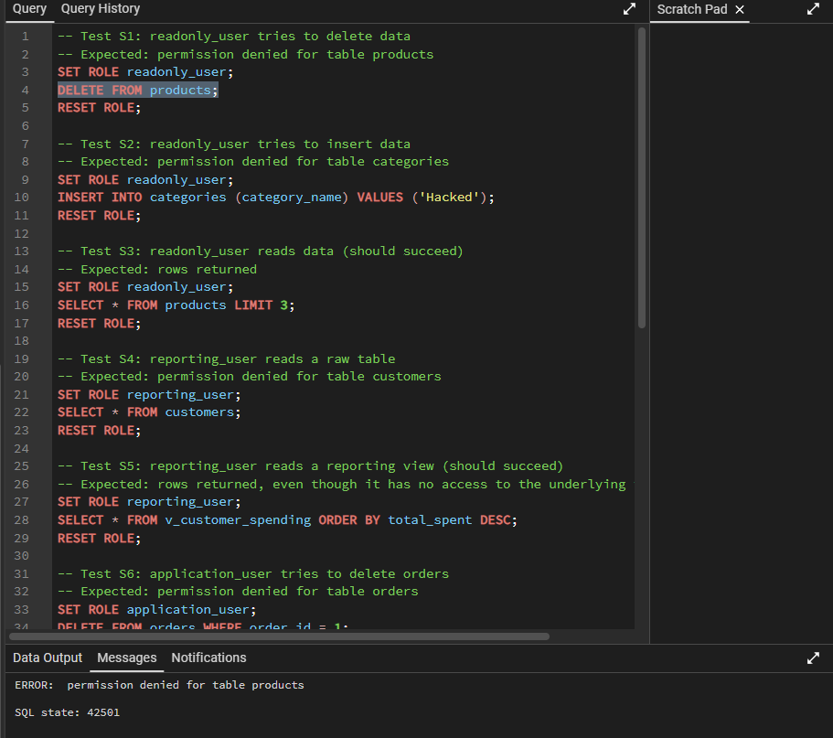
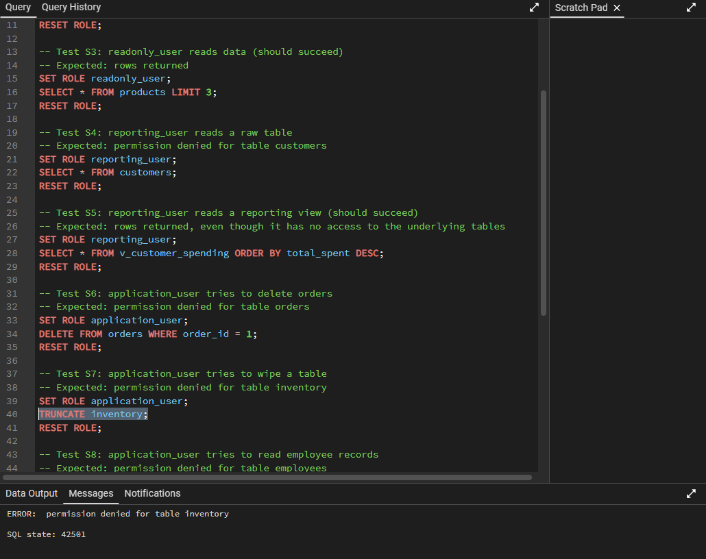
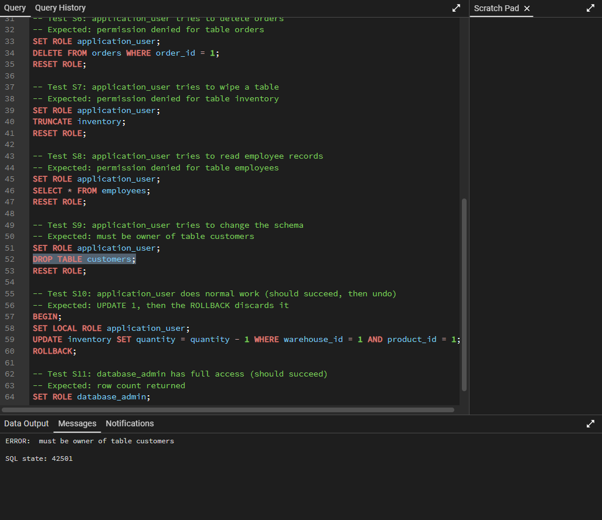

# Incident: Unauthorized Destructive Access Attempts

> **Type:** Simulated incident (access control)
> **Database:** `retail_operations`
> **Outcome:** All destructive attempts were refused by the database; no data was changed

## Summary
Accounts with limited roles attempted operations outside their job: deleting products, inserting records, deleting orders, truncating inventory, reading employee records and dropping a table. Each attempt was refused with SQL state `42501` (insufficient privilege). The tests show that least-privilege roles contain the damage a misused or compromised account can do.

## Scenario
A low-privilege account, such as a read-only reporting login or the application's own account, is misused or compromised. The question is what an attacker or a mistaken user could do with it.

## What was attempted

| # | Role | Attempt | Result | Error |
|---|---|---|---|---|
| S1 | `readonly_user` | `DELETE FROM products` | Refused | permission denied for table products |
| S2 | `readonly_user` | `INSERT INTO categories ...` | Refused | permission denied for table categories |
| S4 | `reporting_user` | `SELECT * FROM customers` | Refused | permission denied for table customers |
| S6 | `application_user` | `DELETE FROM orders WHERE order_id = 1` | Refused | permission denied for table orders |
| S7 | `application_user` | `TRUNCATE inventory` | Refused | permission denied for table inventory |
| S8 | `application_user` | `SELECT * FROM employees` | Refused | permission denied for table employees |
| S9 | `application_user` | `DROP TABLE customers` | Refused | must be owner of table customers |

Full statements, results and screenshots: [`docs/security.md`](../docs/security.md).

## Impact
None. No row was changed, and each refusal happened before the statement ran.

## Why it was contained
- **Public access removed.** Default privileges for `PUBLIC` were revoked, so nothing is accessible unless explicitly granted.
- **No delete rights for the application.** `application_user` has no `DELETE` or `TRUNCATE`. Orders are cancelled by status change, so the application has no reason to remove rows.
- **Ownership.** Only the owner can alter or drop a table, so `application_user` cannot change the schema.
- **Sensitive tables hidden.** `employees` is not readable by the application role.
- **Reporting through views.** `reporting_user` reads views only, with no access to the raw tables (S4 refused, S5 allowed).

## Verification that access still works
Denial tests alone can pass for the wrong reason: during setup, a role with no privileges at all passed every "denied" test. The matching allowed tests confirm the roles still do their jobs:

| # | Role | Action | Result |
|---|---|---|---|
| S3 | `readonly_user` | Read products | Allowed |
| S5 | `reporting_user` | Read `v_customer_spending` | Allowed |
| S10 | `application_user` | Update inventory (rolled back) | Allowed |
| S11 | `database_admin` | Read orders | Allowed |

## What this does not cover
- A compromised `database_admin` or superuser account has full access. Its credentials need the strongest protection.
- The roles have no passwords in this project. A real deployment needs passwords or certificate authentication, plus restrictions in `pg_hba.conf`.
- Refused attempts are not logged anywhere here. Setting `log_min_error_statement` and connection logging would record them for review.
- Row-level security is not used: a role that can read `customers` can read all rows.

## Prevention and follow-up
- Keep each role limited to what its job needs, and re-run [`security_tests.sql`](../database/security_tests.sql) after every change to grants.
- Use a separate role for each application and each person; do not share the admin role.
- Enable statement and connection logging, and review refused attempts.
- Take regular backups. Permissions limit what an account can do, but backups are the recovery if one is ever misused (see [`data-recovery.md`](data-recovery.md)).

## Lessons
- Least privilege turns a possible incident into a logged refusal.
- Test both sides: what a role must be denied, and what it must still be allowed to do.
