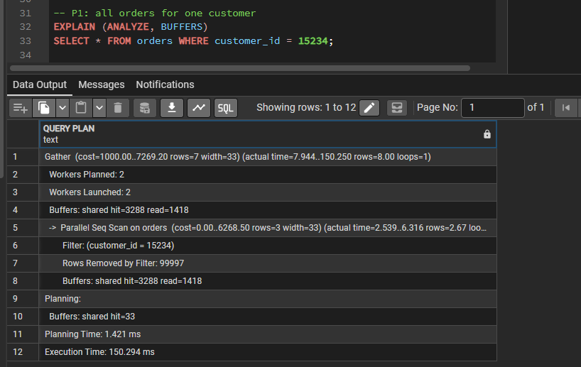
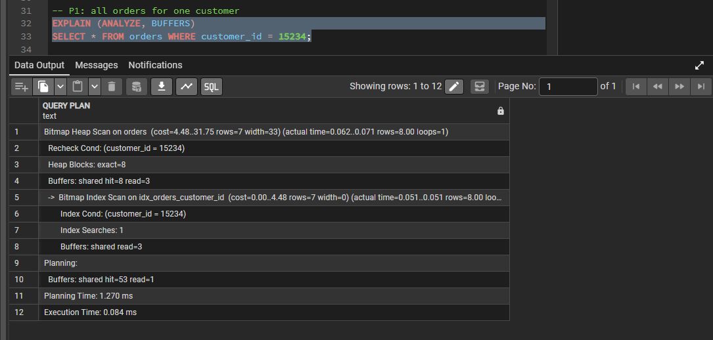

# Incident: Slow Customer Order Lookup

> **Type:** Simulated incident (performance degradation)
> **Database:** `retail_operations`, about 1.4M rows
> **Outcome:** Query time reduced from about 39 ms to 0.084 ms with one index; no downtime, no data change

## Summary
Looking up the orders of a single customer scanned the entire `orders` table. At 300,000 rows the query was still fast enough to go unnoticed, but its cost grows with the table, and every lookup read about 4,700 buffers to return 8 rows. An index on the foreign key column fixed it.

## Scenario
The customer-service screen runs "show this customer's orders" on every call. With a table growing toward millions of rows, a full scan per lookup would turn a minor cost into a slow screen and heavy load on the server.

## Detection
The slow query was found by running `EXPLAIN (ANALYZE, BUFFERS)` on the application's most frequent lookups, not by a user complaint. The monitoring checks in [`docs/monitoring.md`](../docs/monitoring.md) point to the same problem class: tables with a high number of sequential scans (M4) and no matching index (M5).

```sql
EXPLAIN (ANALYZE, BUFFERS)
SELECT * FROM orders WHERE customer_id = 15234;
```

## Investigation
The plan used a `Parallel Seq Scan` over all of `orders` and discarded about 99,997 rows per worker to return 8 rows.

| Measure | Before |
|---|---|
| Scan type | Parallel Seq Scan |
| Rows returned | 8 |
| Buffers touched | about 4,700 |
| Execution time | 150.3 ms (cold cache); about 39 ms warm |

The 150.3 ms figure came from a first run, with data read from disk. A warm run of an equivalent scan takes about 39 ms, so the fair comparison is with the warm figure.



## Root cause
`orders.customer_id` is a foreign key. PostgreSQL enforces the foreign key but does **not** create an index on the referencing column. The primary key index is on `order_id`, so it cannot help a search by `customer_id`. With no usable index, the only option was to read the whole table.

## Resolution
```sql
CREATE INDEX idx_orders_customer_id ON orders (customer_id);
ANALYZE orders;
```

`CREATE INDEX` blocks writes to the table while it builds. On a live system, `CREATE INDEX CONCURRENTLY` avoids that at the cost of a slower build.

## Verification
The same query was rerun with `EXPLAIN (ANALYZE, BUFFERS)`.

| Measure | Before | After |
|---|---|---|
| Scan type | Parallel Seq Scan | Bitmap Index Scan |
| Buffers touched | about 4,700 | 11 |
| Execution time | about 39 ms warm (150.3 ms cold) | 0.084 ms |



The improvement is about 450x against the warm baseline. Index cost: 3,240 kB of disk and a small extra cost on every insert into `orders`.

## Same pattern elsewhere
The same cause appeared in two more queries, and each was fixed with a targeted index. See [`docs/performance.md`](../docs/performance.md) for the full measurements.

| Query | Cause | Fix | Before | After |
|---|---|---|---|---|
| Sales of one product | Primary key `(order_id, product_id)` cannot serve a search by `product_id` | Index on `order_items (product_id)` | 34.7 ms | 0.417 ms |
| Recent stock movements | Filter plus sort over 300,000 rows | Composite index `(product_id, warehouse_id, movement_date DESC)` | 36.3 ms | 0.066 ms |

Two further candidate indexes were measured and rejected because the gain did not justify the write cost (see the Experiments section of `docs/performance.md`).

## Prevention
- Index foreign key columns that are used in lookups, because PostgreSQL does not do this automatically.
- Review `EXPLAIN (ANALYZE, BUFFERS)` for frequent queries before a table grows, not after.
- Re-check sequential vs index scan counts (monitoring query M4) after major releases or data growth.
- Run `ANALYZE` after bulk loads so the planner has accurate row estimates.
- Measure each index before keeping it: an index that does not change the plan only adds cost.

## Lessons
- A query can look healthy at small scale and still be the wrong shape. The buffer count (4,700 pages to return 8 rows) shows the waste better than the timing alone.
- Cold and warm runs differ a lot, so compare like with like.
- A composite index helps when it lets PostgreSQL skip a large sort or stop early, not when the sorted set is tiny.
